

<button id="r2-toggle" class="lang-toggle" type="button" data-lang="zh">EN</button>

  
Research · 研究方向

  <h1 class="title">
    模式识别：从对抗样本到生成式数据增强
    Pattern Recognition: From Adversarial Examples to Generative Data Augmentation
  </h1>
  

    王艺 · 东莞理工学院计算机学院 · 教授（2017–至今）
    Yi Wang · School of Computer Science, Dongguan University of Technology · Professor (2017–present)
  

  

    报告日期：2026-10-31
    Talk date: 2026-10-31
  

  <strong>学术履历</strong>　墨尔本大学 研究助理（2003–2004）· 香港城市大学 助理研究员（2004）· 新南威尔士大学 博士后、副研究员（2009–2012）· 香港浸会大学 研究助理教授、副研究员（2012–2017）· 东莞理工学院 教授（2017–至今，国家级海外高层次人才）
  <strong>Career</strong>　Research Assistant, University of Melbourne (2003–2004) · Research Assistant, City University of Hong Kong (2004) · Postdoctoral Fellow and Research Fellow, UNSW (2009–2012) · Research Assistant Professor and Research Fellow, HKBU (2012–2017) · Professor, DGUT (2017–present; national overseas high-level talent)

研究以模式识别与机器学习为主线，自 2005 年延续至今：从多元数据分析与可视化起步，进入对抗样本的生成与防御、协同训练与知识蒸馏，最终走向生成模型与数据增强。对抗样本揭示模型的脆弱之处，生成式数据增强把这种敏感性转化为可用的多样性——两者共同指向同一个目标：以更优质的数据与更稳健的学习过程，提升模型的鲁棒性与泛化能力。

The research follows a single line — pattern recognition and machine learning — from 2005 to the present: it starts with multivariate data analysis and visualisation, moves into the generation and defense of adversarial examples and into collaborative training with knowledge distillation, and arrives at generative models and data augmentation. Adversarial examples expose where a model is fragile; generative data augmentation turns that same sensitivity into usable diversity. Both serve one goal: better data and more robust learning, for models that are accurate, resilient and generalisable.

  
目录Contents

  <ul>
    <li><a href="#overview">研究领域总览Research Overview</a></li>
    <li><a href="#adversarial-examples">Ⅰ 对抗样本的生成与防御Ⅰ Generating and Defending Adversarial Examples</a></li>
    <li><a href="#collaborative-distillation">Ⅱ 协同训练与知识蒸馏Ⅱ Collaborative Training and Knowledge Distillation</a></li>
    <li><a href="#generative-augmentation">Ⅲ 生成模型与数据增强Ⅲ Generative Models and Data Augmentation</a></li>
    <li><a href="#summary">总结：从对抗样本到生成式数据增强Summary: From Adversarial Examples to Generative Data Augmentation</a></li>
  </ul>

<!-- overview -->

  <h2>研究领域总览Research Overview</h2>

  
研究领域为模式识别与机器学习。二十余年的工作形成四个相互支撑的板块，时间跨度自 2005 年延续至今：

  
The research area is pattern recognition and machine learning. Two decades of work form four mutually supporting blocks, spanning 2005 to the present:

  
2005–2009→2009–2012→2012–2016→2017–2021→2021–2023→2023–

  <table>
    <thead>
      <tr><th>板块Block</th><th>核心内容Focus</th></tr>
    </thead>
    <tbody>
      <tr>
        <td>多元数据分析与可视化Multivariate data analysis &amp; visualisation</td>
        <td>指纹方向场建模；去噪、重建、检索、查询；基于 GLM 与多种重采样方法的高维离散数据统计分析工具包 mvabund，被收录进 CRAN 国际档案大全Fingerprint orientation-field modelling; denoising, reconstruction, retrieval and query; mvabund, a toolbox for high-dimensional discrete data built on GLM with multiple resampling methods, archived in CRAN</td>
      </tr>
      <tr>
        <td>对抗样本攻击与防御Attacks and defenses on adversarial examples</td>
        <td>对抗机器学习（AML）；生物特征隐私保护；安全高效的 CBIR 图像检索系统Adversarial machine learning (AML); biometric privacy protection; secure and query-efficient CBIR systems</td>
      </tr>
      <tr>
        <td>协同训练与知识蒸馏Collaborative training &amp; knowledge distillation</td>
        <td>联邦学习、模型蒸馏、数据集蒸馏Federated learning, model distillation and dataset distillation</td>
      </tr>
      <tr>
        <td>生成模型与适配器Generative models &amp; adapters</td>
        <td>数据增强、参数高效微调（PEFT）Data augmentation and parameter-efficient fine-tuning (PEFT)</td>
      </tr>
    </tbody>
  </table>

<!-- adversarial-examples -->

  <h2>Ⅰ · 对抗样本的生成与防御Ⅰ · Generating and Defending Adversarial Examples</h2>

  
该方向覆盖对抗机器学习、对抗训练与对抗检索：从传统学习的平稳性假设出发，给出对抗样本的生成方法、联邦学习中的隐私泄露路径，以及提升集成模型对抗稳健性的途径。

  
This direction covers adversarial machine learning, adversarial training and adversarial retrieval: starting from the stationarity assumption of classical learning, it presents how adversarial examples are generated, how privacy leaks in federated learning, and how the robustness of deep ensembles can be improved.

  <h3>对抗机器学习Adversarial Machine Learning</h3>
  
静态环境下的平稳性假设是传统机器学习的前提：训练/测试数据独立同分布，统计特性不随时间改变，模型有效性、预测可靠性与统计检验性由此成立。开放环境下，白盒攻击、黑盒攻击、绕过检测与数据投毒使这一假设失效，对抗样本的生成与防御因此成为模型落地的必要环节。

  
Stationarity in a static environment underpins classical machine learning: training and test data are independent and identically distributed, and statistical properties do not drift, so model validity, prediction reliability and statistical testability hold. In an open environment, white-box attacks, black-box attacks, detection bypassing and data poisoning break that assumption — generating and defending adversarial examples becomes indispensable for deployment.

  <ul class="zh">
    <li><strong>静态环境下的平稳性假设</strong>：训练/测试数据独立同分布；统计特性不随时间改变。</li>
    <li><strong>该假设支撑</strong>：模型有效性、预测可靠性与统计检验性。</li>
    <li><strong>开放环境下</strong>的对抗样本生成与防御：白盒攻击、黑盒攻击、绕过检测、数据投毒。</li>
  </ul>
  <ul class="en">
    <li><strong>Stationarity in a static environment</strong>: training and test data are i.i.d., and statistical properties do not drift over time.</li>
    <li><strong>What it underpins</strong>: model validity, prediction reliability and statistical testability.</li>
    <li><strong>In an open environment</strong>, adversarial examples are generated and defended against: white-box attacks, black-box attacks, detection bypassing and data poisoning.</li>
  </ul>
  

    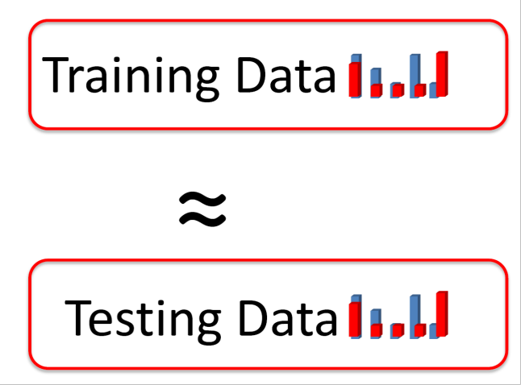
    
图1 平稳性假设：训练数据分布 ≈ 测试数据分布。Figure 1 Stationarity: the training data distribution is assumed to match the test data distribution.

  

  <h3>基于内容查询的图像检索攻击Attacking Content-Based Image Retrieval</h3>
  
针对 CBIR 系统提出一种自适应的决策型黑盒算法，大幅减少 87% 的系统查询次数，并成功在微软必应 Bing 等商业检索引擎上展示了攻击有效性：原始检索结果（wardrobe）被对抗检索样本改写为 tapestry、painting、tiles 等无关结果。

  
For CBIR systems we propose an adaptive decision-based black-box algorithm that cuts system queries by 87%, and we demonstrate its effectiveness on commercial engines such as Microsoft Bing: the original retrieval results (wardrobe) are rewritten by an adversarial retrieval sample into unrelated results such as tapestry, painting and tiles.

  

    
    
图2 微软必应视觉检索：在商业 CBIR 系统上验证攻击有效性。Figure 2 Microsoft Bing visual search: validating the attack on a commercial CBIR system.

  

  
M. Chen, J. Lu, Y. Wang, J. Qin and W. Wang. “DAIR: A Query-Efficient Decision-Based Attack On Image Retrieval Systems”, <em>ACM SIGIR’21</em> [C], 2021, Virtual Event, 1064–1073.

  <h3>联邦学习中的数据重构与隐私泄露Data Reconstruction and Privacy Leakage in Federated Learning</h3>
  
根据客户端上传到服务器的信息，对其本地数据集实施隐私保护攻击，包括样本重构、参数泄漏、成员推断、属性推断等。

  
From the information that clients upload to the server, privacy attacks are mounted on their local datasets — sample reconstruction, parameter leakage, membership inference and property inference.

  <ul class="zh">
    <li>对客户端的本地数据集进行属性推断。</li>
    <li>给出客户端样本重构的准确率比较。</li>
  </ul>
  <ul class="en">
    <li>Property inference on a client’s local dataset.</li>
    <li>Accuracy comparison of client-side sample reconstruction.</li>
  </ul>
  

    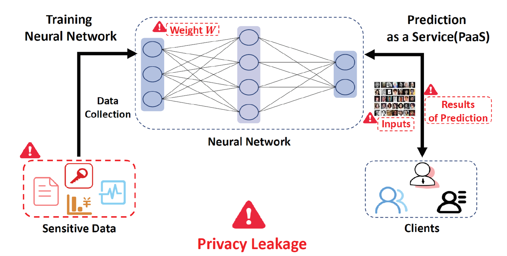
    
图3 隐私泄露路径：客户端数据 → 训练参数 → 云服务（PaaS）→ 预测结果。Figure 3 The privacy leakage path: client data → training parameters → cloud service (PaaS) → prediction results.

  

  
H. Yang, Y. Wang and B. Li. “Individual Property Inference Over Collaborative Learning In Deep Feature Space”, <em>IEEE ICME’22</em> [C], 2022, Taipei, Taiwan, 1–6.

  <h3>集成深度模型的对抗稳健性Adversarial Robustness of Deep Ensembles</h3>
  
基模型高层特征的多样化表示可以显著提升集成深度学习模型的对抗稳健性，据此提出优先多样化 Dropout（Priority Diversified Dropout, PDD）与分散式集成梯度（Dispersed Ensemble Gradients, DEG）。

  
Diversified high-level feature representations across base networks markedly improve the adversarial robustness of deep ensembles, realised as Priority Diversified Dropout (PDD) and Dispersed Ensemble Gradients (DEG).

  <ul class="zh">
    <li><strong>PDD</strong>：优先多样化 Dropout，促使各基网络学习差异化的高层特征。</li>
    <li><strong>DEG</strong>：分散式集成梯度，抑制基网络梯度同质化。</li>
    <li>CIFAR-100 上 2000 张测试图像的平均判别分数箱线图（K = 3）：分数越高，基网络间 FC 特征差异越大。</li>
    <li>Grad-CAM 对比各基网络最后一层 FC 的关注区域：(a) 基线、(b) ADP、(c) PDD。</li>
  </ul>
  <ul class="en">
    <li><strong>PDD</strong>: priority diversified dropout, pushing base networks towards differentiated high-level features.</li>
    <li><strong>DEG</strong>: dispersed ensemble gradients, countering gradient homogenisation across base networks.</li>
    <li>Box-plots of the average discrimination score over 2000 CIFAR-100 test images (K = 3): a higher value means larger FC-feature divergence between base networks.</li>
    <li>Grad-CAM comparison of the last FC layer of each base network: (a) baseline, (b) ADP, (c) PDD.</li>
  </ul>
  

    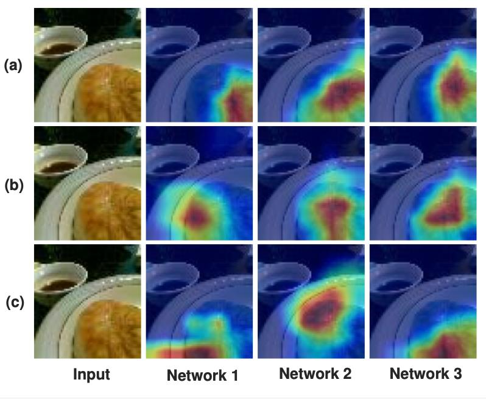
    
图4 各基网络最后一层 FC 的 Grad-CAM 对比：(a) 基线、(b) ADP、(c) PDD（本文方法）。Figure 4 Grad-CAM of the last FC layer in each base network: (a) baseline, (b) ADP, (c) PDD (ours).

  

  
B. Huang, Z. Ke, Y. Wang, W. Wang, L. Shen and F. Liu. “Adversarial Defence By Diversified Simultaneous Training Of Deep Ensembles”, <em>AAAI’21</em> [C], 2021, Virtual Event, 35(9), 7823–7831.

<!-- collaborative-distillation -->

  <h2>Ⅱ · 协同训练与知识蒸馏Ⅱ · Collaborative Training and Knowledge Distillation</h2>

  
该方向围绕联邦学习、师生模型、模型蒸馏与对抗蒸馏展开，核心矛盾是：多客户端长尾数据导致协作偏差并影响收敛。研究关注模型鲁棒性与泛化能力、隐私—效用与通信效率、多模态表征对齐与多路编码器融合策略，以及多场景应用下的模型泛化与自适应能力。

  
This direction covers federated learning, teacher–student models, model distillation and adversarial distillation. The central tension: long-tailed data across many clients induces collaboration bias and hurts convergence. The work addresses model robustness and generalisation, privacy–utility and communication efficiency, multimodal representation alignment with multi-encoder fusion, and cross-scenario generalisation and adaptivity.

  <h3>联邦蒸馏解决长尾数据分布导致的协作偏差Federated Distillation against Long-Tailed Collaboration Bias</h3>
  
多客户端数据呈现长尾分布（Non-IID），带来安全隐私保护、客户端过拟合、收敛慢且不稳定等问题，并造成分类器偏差与泛化能力不足。应对之道是“联邦蒸馏 + 数据增强”：基于实例的自然采样（更适合表示学习）与基于类别的均衡采样（更适合分类器学习）互补，联邦蒸馏优化聚合策略，数据增强平滑统计异质性，并对分类器偏差进行校准。

  
Client data are long-tailed (non-IID), raising privacy protection, client over-fitting, and slow or unstable convergence, and producing classifier bias with limited generalisation. The answer is federated distillation plus data augmentation: instance-based natural sampling (better suited to representation learning) complements class-based balanced sampling (better suited to classifier learning); federated distillation optimises the aggregation strategy, data augmentation smooths statistical heterogeneity, and classifier bias is calibrated.

  <ul class="zh">
    <li><strong>长尾 Non-IID 带来的问题</strong>：安全隐私保护、客户端过拟合、收敛慢不稳定。</li>
    <li><strong>后果</strong>：分类器偏差、泛化能力不足。</li>
    <li><strong>应对</strong>：联邦蒸馏优化聚合策略；数据增强平滑统计异质性；两类采样互补；对分类器偏差进行校准。</li>
  </ul>
  <ul class="en">
    <li><strong>Challenges of long-tailed non-IID data</strong>: privacy protection, client over-fitting, slow and unstable convergence.</li>
    <li><strong>Consequences</strong>: classifier bias and limited generalisation.</li>
    <li><strong>Response</strong>: federated distillation optimises aggregation; data augmentation smooths statistical heterogeneity; the two sampling schemes complement each other; classifier bias is calibrated.</li>
  </ul>
  

    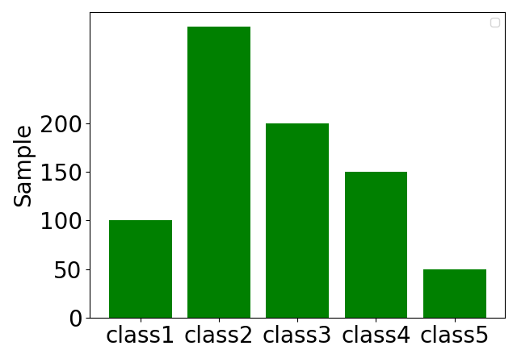
    
图5 客户端本地数据的类别分布：长尾导致协作偏差与分类器偏置。Figure 5 Class distribution of client data: the long tail induces collaboration bias and classifier bias.

  

  <h3>客户端自蒸馏Client Self-Distillation</h3>
  
通过引入随机变换生成的蒸馏数据，并结合多个子网络的软标签对齐（Logits Transfer），增强模型内部知识多样性，抑制本地过拟合。

  
Distillation data produced by random transformations, combined with soft-label alignment (logits transfer) across multiple sub-networks, strengthens intra-model knowledge diversity and suppresses local over-fitting.

  

    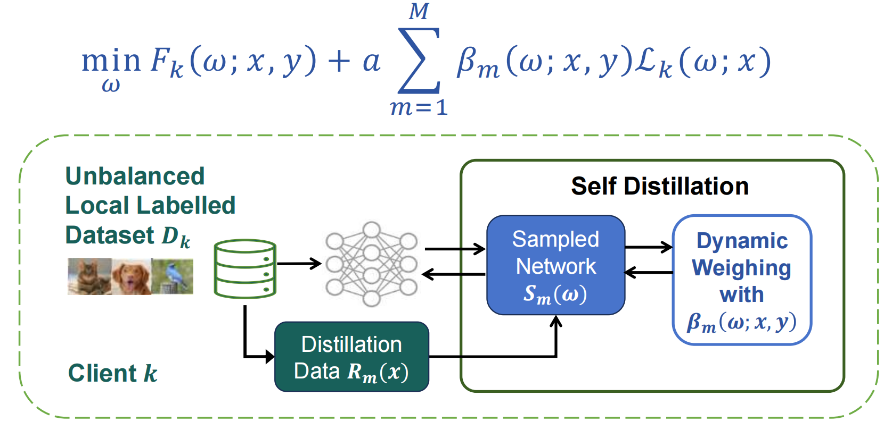
    
图6 客户端自蒸馏：随机变换生成蒸馏数据，并通过多个子网络的软标签对齐抑制本地过拟合。Figure 6 Client self-distillation: distillation data from random transforms, with logits transfer across sub-networks to curb local over-fitting.

  

  <h3>服务器集成蒸馏Server Ensemble Distillation</h3>
  
通过类别均衡的第三方无标签代理数据集引导多方位知识迁移，对齐师生模型在其上的特征表示与软标签。三重对齐模型权重、特征表示与软标签输出，学习更紧凑的特征并优化损失空间结构，提升全局模型的鲁棒性和泛化能力。

  
A class-balanced, third-party unlabeled proxy dataset steers multi-faceted knowledge transfer, aligning teacher and student representations and soft labels on it. Triple alignment — model weights, feature representations and soft-label outputs — yields more compact features and a better-structured loss space, improving global robustness and generalisation.

  
minΩ η·ℒlogits(Ω; x̂) + ν·ℒfeature(Ω; x̂)

  

    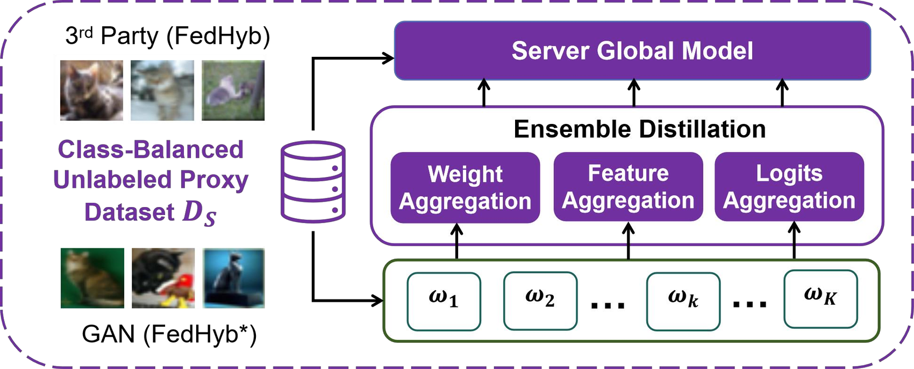
    
图7 服务器集成蒸馏（FedHyb）：在类别均衡的无标签代理数据集上做权重、特征与软标签三重聚合。Figure 7 Server ensemble distillation (FedHyb): weight, feature and logits aggregation on a class-balanced unlabeled proxy dataset.

  

  
S. Liu, Y. Zhang, K. Zhang and Y. Wang. “Federated Learning with Hybrid Knowledge Distillations on Long-Tailed Heterogeneous Client Data”, <em>ECAI’24</em> [C], 2024, Santiago de Compostela, Spain, vol. 392, 2878–2885.

  <h3>突破联邦学习在长尾异构下的性能瓶颈Breaking the Long-Tailed Heterogeneity Bottleneck</h3>
  <ul class="zh">
    <li>不同数据异质性影响下的全局模型测试准确率更高（数据异构性指标 α、长尾分布指标 IF）。</li>
    <li>医学影像基准数据集 CheXpert 上的全局准确率更高。</li>
    <li>达到目标精度所需通信轮次显著减少。</li>
    <li>对恶意客户端下毒攻击更鲁棒（随机噪声攻击、拜占庭攻击）。</li>
  </ul>
  <ul class="en">
    <li>Higher global test accuracy under different levels of data heterogeneity (heterogeneity index α, long-tail indicator IF).</li>
    <li>Higher global accuracy on the medical imaging benchmark CheXpert.</li>
    <li>Markedly fewer communication rounds to reach a target accuracy.</li>
    <li>More robust to poisoning by malicious clients (random-noise and Byzantine attacks).</li>
  </ul>
  

    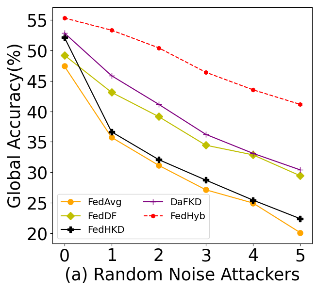
    
图8 随机噪声攻击下的全局准确率（α = 0.5）。Figure 8 Global accuracy under random-noise attackers (α = 0.5).

  

  <h3>自适应的对抗蒸馏法（AdaAD）Adaptive Adversarial Distillation (AdaAD)</h3>
  
传统对抗训练方法在小容量学生模型上提升鲁棒性的效果并不理想，常出现模型精度与鲁棒性之间的失衡。AdaAD 在对抗博弈框架下优化大小模型之间的蒸馏过程：

  
Conventional adversarial training struggles to improve robustness on small-capacity student models, often trading accuracy for robustness. AdaAD optimises teacher–student distillation inside an adversarial-game framework:

  <ul class="zh">
    <li>模拟近似推导大小模型之间的最大点对点对齐关系。</li>
    <li>在内部优化过程中自适应地搜索最优匹配点（锚点）。</li>
    <li>通过小模型生成对抗训练数据，增加大小模型之间的互动。</li>
    <li>设计新的对抗蒸馏目标。</li>
  </ul>
  <ul class="en">
    <li>Derive, by simulation, the maximal point-to-point alignment between the two models.</li>
    <li>Adaptively search for the best matching point (anchor) during inner optimisation.</li>
    <li>Generate adversarial training data through the student to increase teacher–student interaction.</li>
    <li>Design a new adversarial distillation objective.</li>
  </ul>
  

    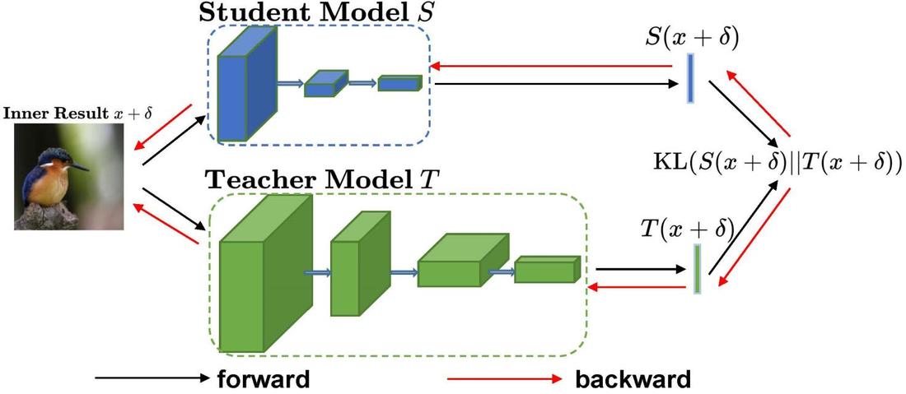
    
图9 自适应对抗蒸馏法的内部优化过程。Figure 9 The inner optimisation process of adaptive adversarial distillation.

  

  
B. Huang, M. Chen, Y. Wang, J. Lu, M. Cheng and W. Wang. “Boosting Accuracy and Robustness Of Student Models Via Adaptive Adversarial Distillation”, <em>IEEE/CVF CVPR’23</em> [C], 2023, Vancouver, Canada, 24668–24677.

<!-- generative-augmentation -->

  <h2>Ⅲ · 生成模型与数据增强Ⅲ · Generative Models and Data Augmentation</h2>

  
该方向覆盖数据增强、数据集蒸馏与参数高效的模型微调（PEFT）：以生成模型为工具，为下游任务合成、筛选或对齐数据。

  
This direction covers data augmentation, dataset distillation and parameter-efficient fine-tuning (PEFT): generative models are used to synthesise, select or align data for downstream tasks.

  <h3>图像生成模型Image Generation Models</h3>
  
图像生成沿三条技术路线展开：生成式对抗网络 GAN、自回归 Transformer 与 Diffusion 扩散模型。四条需求共同定义了好模型的标准——满足小样本学习、符合常理和常识、减少算力和内存、具备局部编辑可控性，即可靠、鲁棒、高效。

  
Image generation follows three technical routes — generative adversarial networks (GANs), autoregressive Transformers and diffusion models. Four requirements define a good model: few-shot capability, commonsense plausibility, reduced compute and memory, and controllable local editing — that is, reliable, robust and efficient.

  <ul class="zh">
    <li><strong>技术路线</strong>：GAN、自回归 Transformer、Diffusion 扩散模型。</li>
    <li><strong>需求</strong>：满足小样本学习；符合常理和常识；减少算力和内存；局部编辑可控性。</li>
  </ul>
  <ul class="en">
    <li><strong>Routes</strong>: GANs, autoregressive Transformers, diffusion models.</li>
    <li><strong>Requirements</strong>: few-shot learning; commonsense plausibility; less compute and memory; controllable local editing.</li>
  </ul>
  

    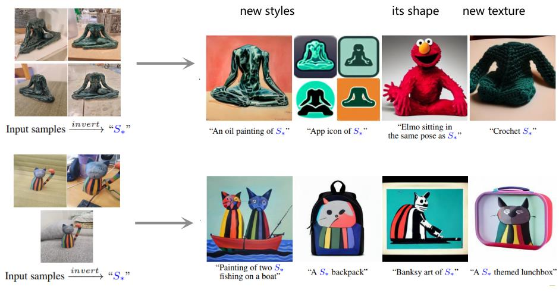
    
图10 图像生成模型的可控编辑：新风格、新形状与新纹理。Figure 10 Controllable editing with image generation models: new styles, new shape and new texture.

  

  <h3>生成式数据增强：对抗数据增强Generative Augmentation: Adversarial Data Augmentation</h3>
  
在主网络中插入鲁棒特征适配器（RFA），通过在特征空间动态自适应地生成对抗扰动，有效解决传统对抗训练计算开销大和鲁棒过拟合的问题；推理阶段插拔 RFA 适配器还可用于对抗检测。

  
A Robustness Feature Adapter (RFA) inserted into the main network dynamically generates adversarial perturbations in feature space, solving the high computational cost and robust over-fitting of conventional adversarial training; the adapter can be plugged in or out at inference for adversarial detection.

  <ul class="zh">
    <li>ViT 对抗训练效率提升 4 倍以上。</li>
    <li>模型复杂度增加不足 1/10。</li>
    <li>鲁棒性增益可超过 50%。</li>
  </ul>
  <ul class="en">
    <li>Over 4× faster adversarial training for ViT.</li>
    <li>Less than 1/10 added model complexity.</li>
    <li>Robustness gains above 50%.</li>
  </ul>
  

    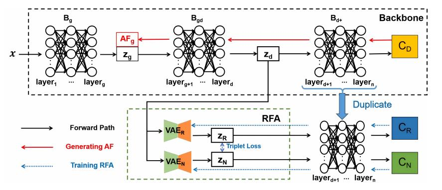
    
图11 RFA 的插入位置与训练/推理流程：仅更新适配器参数即可生成对抗扰动。Figure 11 Where RFA is inserted and its training/inference flow: only adapter parameters are updated.

  

  
Q. Wu, J. Guo, W. Wang and Y. Wang. “Robustness Feature Adapter for Efficient Adversarial Training”, <em>ECAI’25</em> [C], 2025, Bologna, Italy, vol. 413, 3451–3459.

  <h3>“插件式”RFA 对抗训练的收敛质量与效率Convergence Quality and Efficiency of Plug-in RFA</h3>
  <ul class="zh">
    <li><strong>高效性</strong>：RFA 通过仅更新适配器参数，显著降低计算开销，尤其适用于大规模预训练模型（如 ViT）的对抗训练。</li>
    <li><strong>收敛质量</strong>：尽管训练速度快，RFA 仍能保持低 FOSC 值，说明其生成的对抗样本质量高，有助于提升模型鲁棒性泛化能力。</li>
    <li><strong>可迁移</strong>：用于个性化联邦学习，同时增强客户端对抗鲁棒性。</li>
  </ul>
  <ul class="en">
    <li><strong>Efficiency</strong>: updating only adapter parameters sharply cuts computation, which especially suits adversarial training of large pre-trained models such as ViT.</li>
    <li><strong>Convergence quality</strong>: despite fast training, RFA keeps a low FOSC value, indicating high-quality adversarial examples that improve robustness generalisation.</li>
    <li><strong>Transferable</strong>: applicable to personalised federated learning while strengthening client-side adversarial robustness.</li>
  </ul>
  

    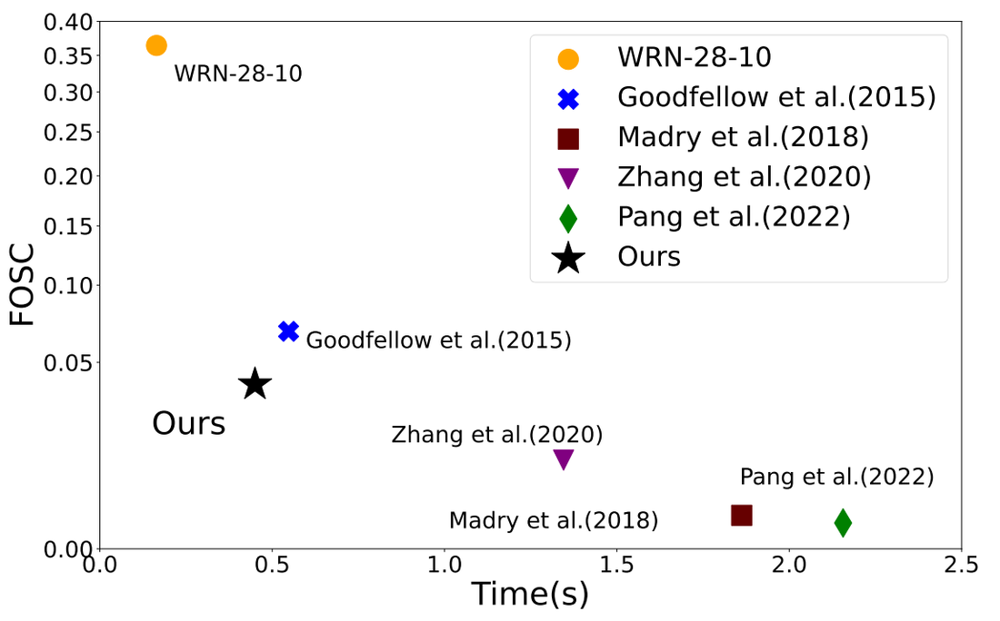
    
图12 每批次训练时间与 FOSC 的关系：兼顾训练效率与对抗样本质量。Figure 12 Training time per batch vs FOSC: efficiency together with adversarial-sample quality.

  

  <h3>生成式数据增强：自适应下游多任务模型Generative Augmentation: Adapting to Downstream Multi-Task Models</h3>
  
情景自适应的数据增强（IGD）在推理阶段利用外部约束（目标梯度），引导反扩散过程动态自适应地生成能够等效训练下游任务模型的代理数据集，实现生成模型免微调、高效率地控制反向去噪过程。

  
Scene-adaptive data augmentation (IGD) uses external constraints — target gradients — at inference time to steer the reverse diffusion process, dynamically generating a proxy dataset that can equivalently train downstream models. The generative model needs no fine-tuning, and the reverse denoising process is controlled efficiently.

  <ul class="zh">
    <li>设计自定义的外部属性梯度作为引导函数。</li>
    <li>在反向去噪的推断采样阶段施加定向吸引力或排斥力。</li>
    <li>引导数据生成过程自适应下游任务目标，避免昂贵的生成模型重训练成本。</li>
  </ul>
  <ul class="en">
    <li>A custom external attribute gradient serves as the guidance function.</li>
    <li>Directed attraction or repulsion is applied during inference-time reverse denoising.</li>
    <li>Generation adapts to the downstream objective, avoiding costly retraining of the generator.</li>
  </ul>
  

    
    
图13 真实样本（虚线左）与生成的代理样本（虚线右）对比。Figure 13 Real samples (left of the dashed line) vs generated proxy samples (right).

  

  
M. Chen, J. Du, B. Huang, Y. Wang, X. Zhang and W. Wang. “Influence-Guided Diffusion for Dataset Distillation”, <em>ICLR’25</em> [C], 2025, Singapore, 1287–1308.

  <h3>生成式数据增强：数据蒸馏代表性样本Generative Augmentation: Representative Samples via Data Distillation</h3>
  
核心数据集蒸馏法（Core-Set Selection）将大型真实数据集的核心知识提炼到小规模合成/筛选数据集，可用于持续/增量学习和边缘设备部署；通过 DDPM 部分逆去噪过程中引发的重建偏差，反映并量化潜在的数据似然度。

  
Core-set selection distils the core knowledge of a large real dataset into a small synthesised or selected set, serving continual/incremental learning and edge deployment. Reconstruction bias induced by partial reverse denoising in DDPM reflects and quantifies the underlying data likelihood.

  <ul class="zh">
    <li><strong>高似然样本</strong>：重构偏差小。</li>
    <li><strong>低似然样本</strong>：语义变化、视觉显著性下降。</li>
    <li><strong>最优重建时刻</strong>：选择 t 同时满足 SNR(t) ∈ [γmin, γmax]。</li>
  </ul>
  <ul class="en">
    <li><strong>High-likelihood samples</strong>: small reconstruction bias.</li>
    <li><strong>Low-likelihood samples</strong>: semantic drift and declining visual saliency.</li>
    <li><strong>Optimal reconstruction step</strong>: choose t with SNR(t) ∈ [γmin, γmax].</li>
  </ul>
  

    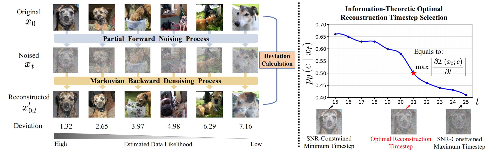
    
图14 以部分逆去噪的重建偏差估计数据似然度，并据此确定最优重建时刻 t。Figure 14 Data likelihood estimated from the reconstruction deviation of partial reverse denoising, yielding the optimal reconstruction timestep t.

  

  
M. Chen, J. Du, B. Huang, Y. Wang, X. Zhang and W. Wang. “Diffusion Reconstruction-based Data Likelihood Estimation for Core-Set Selection”, <em>AAAI’26</em> [C], 2026, Singapore.

  <h3>生成式数据增强：多模态医学图像融合Generative Augmentation: Multimodal Medical Image Fusion</h3>
  
精准性：通过多模态特征融合与分布对齐的协同优化，提高模型对复杂异构数据的表征能力，从而提升整体预测精度。

  
Accuracy: coordinated multimodal feature fusion and distribution alignment strengthen the model’s representation of complex heterogeneous data, raising overall predictive accuracy.

  

    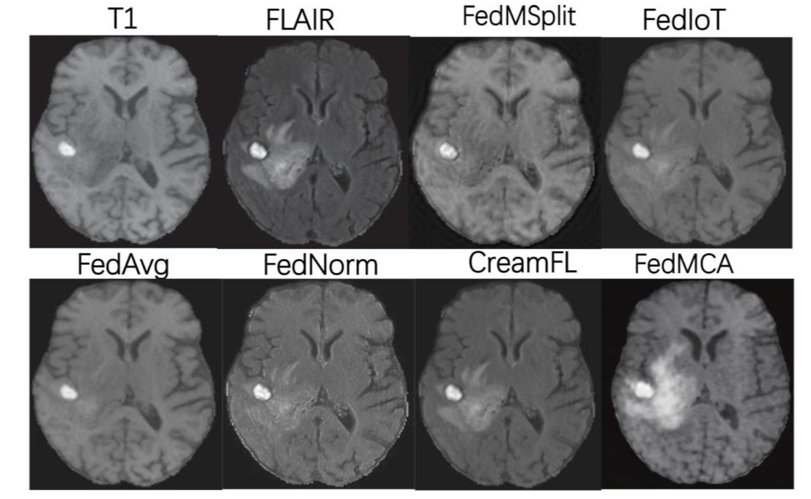
    
图15 多模态医学图像融合结果对比（FedMCA 为本团队方法）。Figure 15 Multimodal medical image fusion results (FedMCA is ours).

  

  
Y. Zhang, S. Liu, B. Fang and Y. Wang. “FedMCA: Cross-Attention-Based Personalized Multimodal Federated Learning Under Modality Heterogeneity”, <em>ICMSSP’26</em> [C], 2026, Hiroshima, Japan.

  <h3>生成式数据增强：单轮通信的联邦学习Generative Augmentation: One-Shot Communication Federated Learning</h3>
  
允许服务器通过单轮通信学习全局模型，有效降低客户端的通信成本和安全风险；数据生成阶段基于对抗博弈的多专家蒸馏融合客户端编码器，模型蒸馏阶段将融合后的集成编码器知识蒸馏到全局模型。

  
The server learns a global model through one round of communication, cutting client communication cost and security risk. In the data-generation stage, multi-expert distillation under an adversarial game fuses client encoders; in the model-distillation stage, the fused ensemble-encoder knowledge is distilled into the global model.

  <ul class="zh">
    <li><strong>无需额外信息交换</strong>：只需在客户端和服务器之间传输模型参数。</li>
    <li><strong>无需辅助数据集</strong>：服务器不需要额外的训练数据（data-free）。</li>
    <li><strong>考虑模型异质性</strong>：适应不同客户端拥有不同的模型架构。</li>
  </ul>
  <ul class="en">
    <li><strong>No extra information exchange</strong>: only model parameters travel between clients and server.</li>
    <li><strong>No auxiliary dataset</strong>: the server needs no additional training data (data-free).</li>
    <li><strong>Model heterogeneity aware</strong>: accommodates clients with different architectures.</li>
  </ul>
  

    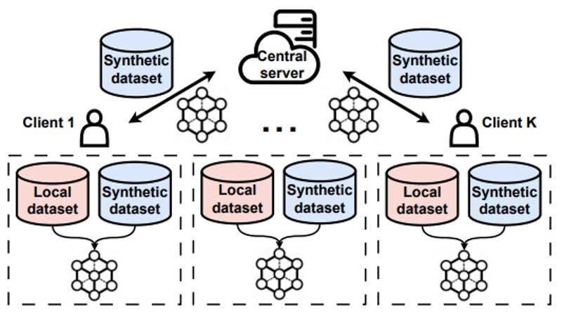
    
图16 单轮通信联邦学习：客户端合成数据与服务器集成蒸馏。Figure 16 One-shot federated learning: client-side synthetic data plus server-side ensemble distillation.

  

  <h3>生成式数据增强：探索超材料结构Generative Augmentation: Exploring Metamaterial Structures</h3>
  
设计物理性合理的超材料结构。超材料具有可编程几何结构，可通过设计几何结构定制特定功能；早期设计依赖人工专业经验和手动设计。研究基于体素化表示构建几何候选体结构，生成过程中的关键问题是平衡合理性、新颖性与多样性。

  
Designing physically plausible metamaterial structures. Metamaterials have programmable geometry, so specific functions can be tailored by designing that geometry; early design relied on expert experience and manual effort. Candidates are built on voxelised representations, and the key issue during generation is balancing plausibility, novelty and diversity.

  

    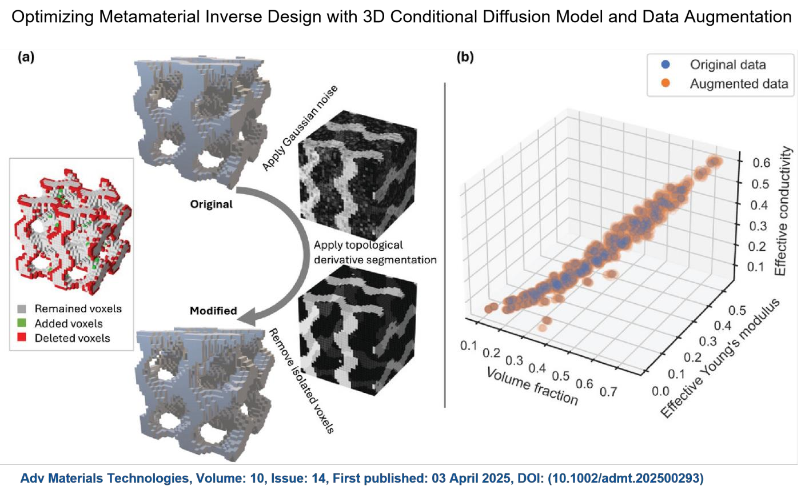
    
图17 超材料逆向设计：三维条件扩散模型与数据增强。Figure 17 Metamaterial inverse design with a 3D conditional diffusion model and data augmentation.

  

<!-- summary -->

  <h2>总结：从对抗样本到生成式数据增强Summary: From Adversarial Examples to Generative Data Augmentation</h2>

  
两条路线共享同一套底层机制——学习数据空间中的有效扰动、利用高维空间的“线性敏感性”，最终都服务于模型的鲁棒性与泛化能力；差别只在于扰动的目标与约束。

  
Both routes share the same underlying mechanisms — learning effective perturbations in data space and exploiting the linear sensitivity of high-dimensional space — and both ultimately serve robustness and generalisation. They differ only in the objective and the constraints placed on the perturbation.

  <table>
    <thead>
      <tr>
        <th>维度Dimension</th>
        <th>对抗样本Adversarial examples</th>
        <th>生成式数据增强Generative data augmentation</th>
      </tr>
    </thead>
    <tbody>
      <tr>
        <td>学习数据空间的有效扰动Effective perturbation in data space</td>
        <td>约束条件下的定向扰动生成，目标“破坏模型性能”Constrained, targeted perturbation generation aimed at breaking model performance</td>
        <td>分布约束下的自然扰动生成，目标“保持语义、增加变化”Distribution-constrained, natural perturbation aimed at preserving semantics while adding variation</td>
      </tr>
      <tr>
        <td>利用高维空间的“线性敏感性”Linear sensitivity of high-dimensional space</td>
        <td>定向累积扰动实现错误分类Accumulating targeted perturbations to force misclassification</td>
        <td>微小扰动不改变语义、仅增加多样性Small perturbations that leave semantics intact and add diversity</td>
      </tr>
      <tr>
        <td>提升模型的鲁棒性与泛化能力Robustness and generalisation</td>
        <td>通过对抗训练暴露模型的脆弱点，学会应对攻击（安全威胁）Adversarial training exposes vulnerabilities so the model learns to resist attacks (security threats)</td>
        <td>通过补充训练数据覆盖更多场景，缓解数据稀缺、分布偏移Supplementary training data cover more scenarios, relieving data scarcity and distribution shift</td>
      </tr>
    </tbody>
  </table>

  
核心判断：模型能力上限取决于数据质量、结构与组织方式。Core claim: a model’s capability ceiling is set by data quality, structure and organisation.

  
从对抗样本到生成式数据增强From adversarial examples to generative data augmentation

  

    
THANK YOU！

    
联系邮箱Email：<a href="mailto:wangyi@dgut.edu.cn">wangyi@dgut.edu.cn</a>

  

